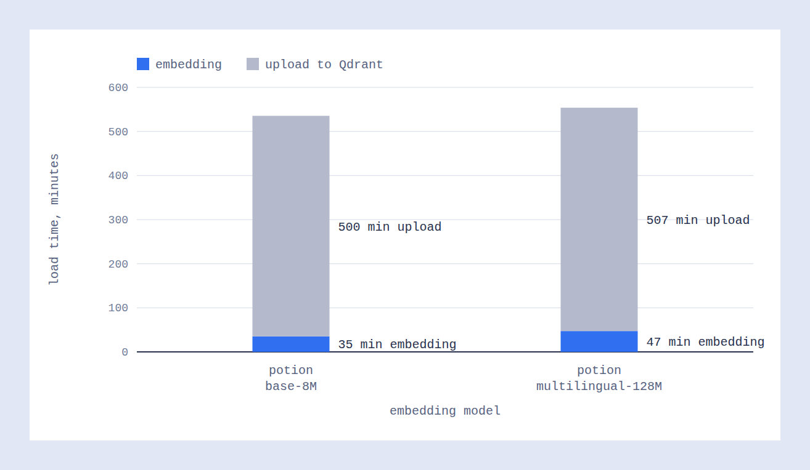
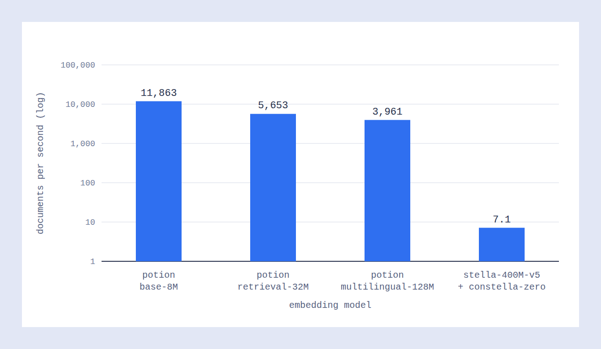
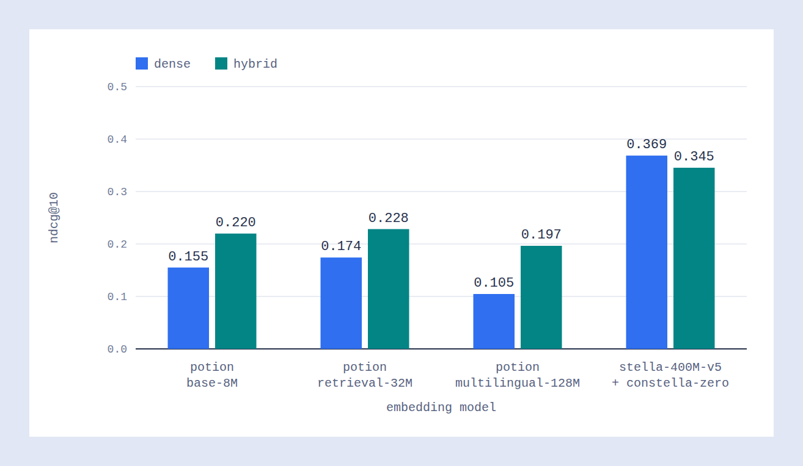
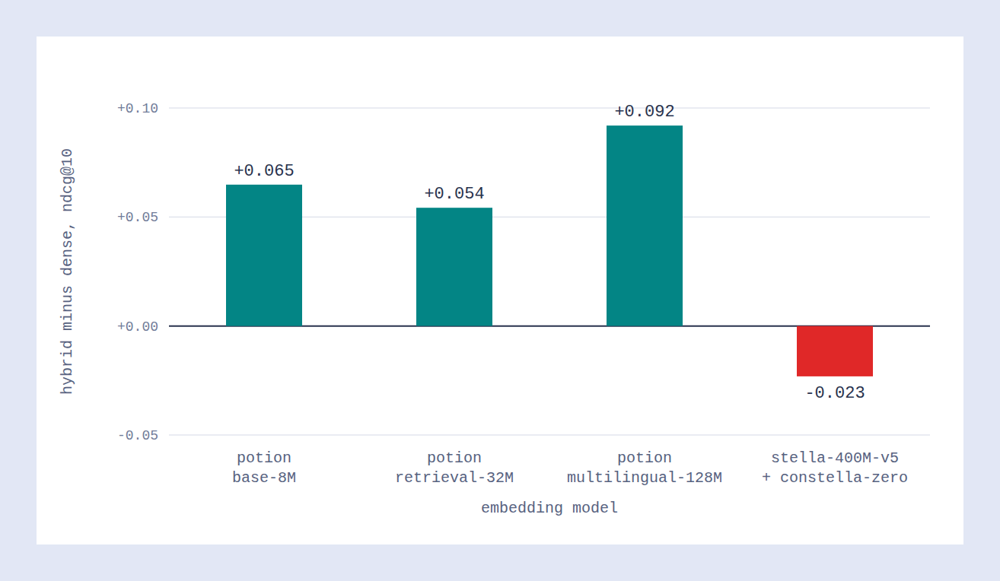
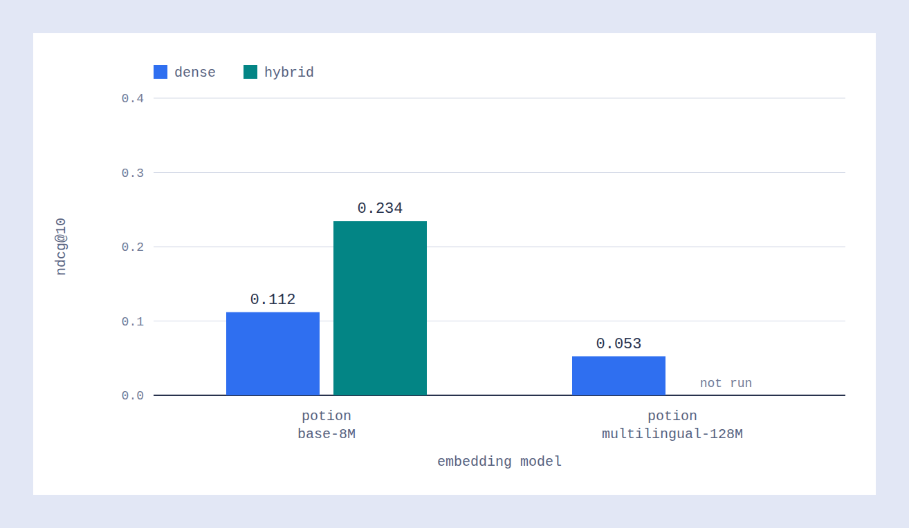

# 32M Embeddings in 40 Minutes with Static Embeddings

Static embedding models turn text into vectors by table lookup, with no neural network in the loop. That makes them very cheap to run, and it has a price in retrieval quality. We wanted to put numbers on both sides, so we added static models to FastEmbed, loaded the full English MIRACL corpus (about 32.9 million passages) into Qdrant with them, and measured how well they retrieve.

The short version: embedding the whole corpus took 35 to 47 minutes on one machine, and the same models score well below a transformer-based dense model on FiQA. Hybrid search with BM25 closes part of that gap.

## What Static Embeddings Are

A transformer encoder reads a text token by token and runs every token through many layers of attention. The vector it returns depends on the whole sentence, which is why "bank" gets a different representation in "river bank" and "bank account". It also means the cost grows with the size of the model and the length of the text.

A static embedding model drops the network: it keeps one fixed vector for each token in its vocabulary and, to embed a text, the model does three things:

1. Tokenize the text.
2. Look up the vector of each token.
3. Average the vectors and normalize the result.

That is the whole model: a tokenizer and a matrix. Word order and context are lost, so the result is closer to a learned bag of words than to a sentence encoder. What you get back is speed. There is nothing to run on a GPU, the model files are small (30 MB for `potion-base-8M`), and the embedding cost is dominated by tokenization.

The vectors themselves come from a larger sentence transformer. The [Model2Vec](https://github.com/MinishLab/model2vec) approach behind the `potion` family distills a transformer into a token table, so the table keeps some of the transformer's notion of meaning even though it can't model context at query time.

We used four models in this benchmark:

| Model | Dimensions | File size | Notes |
|---|---|---|---|
| `potion-base-8M` | 256 | 30 MB | General-purpose, English |
| `potion-retrieval-32M` | 512 | 129 MB | Tuned for retrieval, English |
| `potion-multilingual-128M` | 256 | 512 MB | Multilingual |
| `stella_en_400M_v5` with `constella-zero` | 1,024 | 1.75 GB (documents) and 31 MB (queries) | Transformer for documents, static table for queries |

The last row isn't a purely static model, and it needs a closer look. `constella-zero` is a query-side lookup table that embeds text into the document space of `stella_en_400M_v5`. You embed documents once with the full stella transformer, which is slow but happens offline. At query time you embed the query with the table, which is instant. This pairing keeps most of a transformer's document representation and still gives you static speed on the query path. In this post, "the stella pipeline" means that setup. It is our stand-in for a strong dense model, and it is the quality reference in the FiQA results.

## What We Built in FastEmbed

We added static model support to [FastEmbed](https://github.com/qdrant/fastembed). A static model loads as a token table plus a tokenizer, and FastEmbed pools the token vectors with numpy, so there is no neural network, ONNX graph, or GPU involved. The tokenizer is the main cost. Models also differ in how they pool tokens: `constella-zero` handles special and repeated tokens differently from the `potion` models, so each model carries its own settings.

The patched FastEmbed, the benchmark code, and the raw results are in the [miracl-static-embeddings repository](https://github.com/qdrant-labs/miracl-static-embeddings).

## Setup

We ran two corpora:

- **MIRACL English.** The full corpus has about 32.9 million passages. We evaluated with the 2,863 training queries that have relevance judgments.
- **FiQA.** A financial question answering set from BEIR with 57,638 documents. We evaluated with the 5,500 training queries.

We tested two retrieval modes. Dense search uses one vector per passage. Hybrid search adds a BM25 sparse vector computed by Qdrant and fuses the two rankings with reciprocal rank fusion (RRF). Search returns the top 10 passages per query.

We report nDCG@10, MRR@10, and recall@10. All scores are means over queries, and a query with no relevant documents scores 0.

We ran every load on one MacBook Pro with an M4 Max chip (14 cores, ARM64) and 48 GiB of RAM. The target was a Qdrant Cloud cluster with 8 vCPUs, 64 GiB of RAM, and 512 GiB of disk, deployed in a region close to the laptop. Embedding times are local compute, and upload times include the network round trip and Qdrant's ingestion, so they depend on that distance and on the cluster size. In the stella pipeline, documents ran through ONNX Runtime on the CPU, and queries used the same numpy backend as the static models.

## Loading 32 Million Passages

Loading means embedding each batch of 256 passages and uploading it to Qdrant. We timed both steps for every batch.

| Model | Embedding time | Throughput | Upload time | Total |
|---|---|---|---|---|
| `potion-base-8M` | 35 min | 15,563 passages per second | 8.3 h | 8.9 h |
| `potion-multilingual-128M` | 47 min | 11,613 passages per second | 8.4 h | 9.2 h |

The static models embed the whole corpus in under an hour. That is 6.6% of the load time for the 8M model and 8.5% for the 128M model. The rest is upload, which depends on the network and on how fast Qdrant ingests, and it doesn't change with the embedding model. In other words, once the embedder is this fast, the load is limited by moving the data, and a bigger static model costs only a few more minutes.

To see what that means in practice, compare it with a transformer on a smaller corpus. We loaded FiQA with every model and measured embedding throughput.

| Model | Throughput on FiQA |
|---|---|
| `potion-base-8M` | 11,863 documents per second |
| `potion-retrieval-32M` | 5,653 documents per second |
| `potion-multilingual-128M` | 3,961 documents per second |
| `stella_en_400M_v5` (documents) | 7.1 documents per second |

The 8M model is roughly 1,700 times faster than the stella document encoder on the same corpus. At 7.1 documents per second, the 32.9 million MIRACL passages would take about 53 days. That is a rough extrapolation from FiQA, whose documents differ in length from MIRACL passages, so treat it as an order of magnitude. It also comes from a single run on the laptop, and a GPU could move it a lot.

## What the Speed Costs in Quality

Speed isn't free. On FiQA, every static model scores well below the stella pipeline.

| Model | Dense nDCG@10 | Hybrid nDCG@10 |
|---|---|---|
| `potion-base-8M` | 0.155 | 0.220 |
| `potion-retrieval-32M` | 0.174 | 0.228 |
| `potion-multilingual-128M` | 0.105 | 0.197 |
| stella with `constella-zero` | 0.369 | 0.345 |

The best dense static model, `potion-retrieval-32M`, reaches 47% of the stella pipeline's nDCG@10. The multilingual 128M model does worst at 28%, which makes sense: it spends its capacity on other languages, and FiQA is English. A larger static table doesn't help much when the lookup can't model context.

Hybrid search narrows the gap. BM25 adds exact term matching, which a bag of averaged token vectors handles poorly on its own. With hybrid search, the static models reach 53% to 62% of the stella dense score. The gain is largest for the weakest dense model (+0.092 for the 128M model) and smallest for the 32M model (+0.054).

Hybrid search slightly hurts the stella pipeline (-0.023). Its dense scores are already strong, and fusing in a weaker BM25 ranking pulls good results down.

## MIRACL Results

On the full MIRACL English corpus, the picture is the same in shape.

| Setup | nDCG@10 | MRR@10 | recall@10 |
|---|---|---|---|
| `potion-base-8M`, dense | 0.112 | 0.141 | 0.158 |
| `potion-multilingual-128M`, dense | 0.053 | 0.070 | 0.072 |
| `potion-base-8M`, hybrid | 0.234 | 0.295 | 0.309 |

Hybrid search doubles the nDCG@10 of the 8M model, from 0.112 to 0.234. Retrieving from 32.9 million passages is a much harder problem than retrieving from 57,638, so absolute scores are low for every setup. We didn't run the stella pipeline on MIRACL for the reason in the throughput section, so there is no transformer baseline on this corpus. The quality gap in this post comes from FiQA only.

## What This Means

Static embeddings suit the case where embedding volume is the problem. If you need to embed tens of millions of passages quickly, re-embed often, or run on hardware without a GPU, they turn the embedding step from the bottleneck into a rounding error. Upload time dominates the load.

They don't replace a good dense model on quality. If retrieval quality is what matters, a transformer on the document side is still far ahead on FiQA, and the asymmetric stella setup shows one way to keep its quality while making the query path cheap. Hybrid search is the most effective fix we measured for static models, and it costs one extra sparse vector per point.

<!--## Caveats

- Each number comes from a single run. We didn't measure variance.
- We evaluated on training queries, with default search settings and no tuning.
- Embedding throughput on FiQA and MIRACL isn't directly comparable: the corpora differ, and the FiQA runs used different batch sizes (the batch counts imply 256 for the 8M model and 64 for the others).
- The stella throughput comes from one run on a laptop. A GPU, a different execution provider, or a quantized export would move it.
- The multilingual model is penalized by an English-only benchmark. It deserves a multilingual one.
- The hybrid run for `potion-multilingual-128M` on MIRACL isn't finished yet.

## Notes for the Next Draft (Remove Before Publishing)

- Check the Model2Vec description against the Model2Vec documentation, and add the exact base model of each `potion` variant.
- Confirm that the MIRACL English corpus has 32.9 million passages (we inferred it from 128,490 batches of 256).
- Decide whether to add a stella run on a sample of MIRACL, so the quality gap has a second data point.
- Run `potion-retrieval-32M` on the full MIRACL corpus.
- Add the quantization results (scalar, binary, TurboQuant) if they belong in this post.-->
